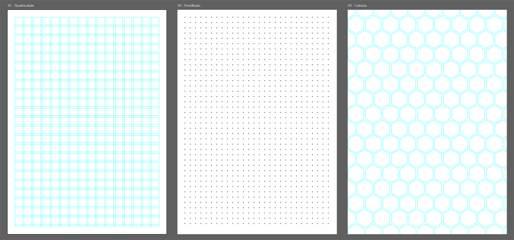
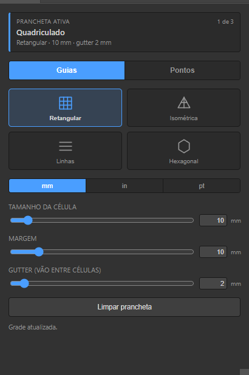
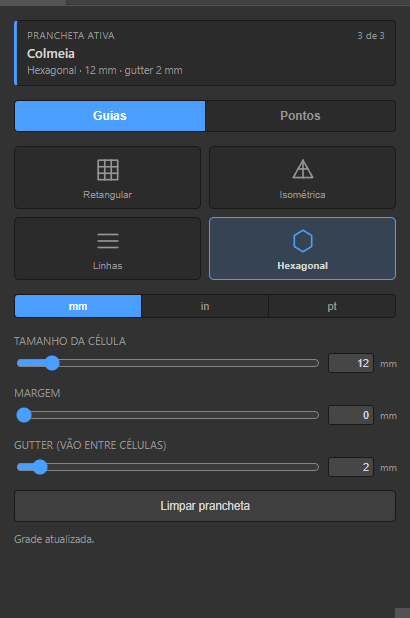
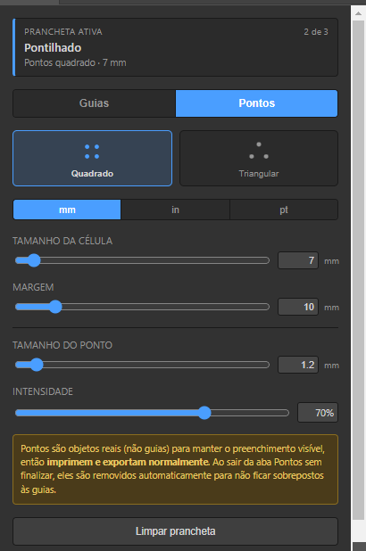

# AutoGrids

Painel para o Adobe Illustrator que cria grades de referência na prancheta ativa — quadriculado, isométrico, pautado, hexagonal e pontilhado — ajustando ao vivo enquanto você arrasta os controles. Cada prancheta tem a sua própria grade.

> **Versão 1.1.0 — em validação.** Esta versão é para testar o uso no dia a dia; a interface do painel e do instalador vai ser redesenhada em breve. Encontrou algo estranho? Abra uma [issue](https://github.com/warroma/adobe-illustrator-autogrids/issues).



<table>
  <tr>
    <td align="center"><br><sub><b>Guias</b> — retangular com gutter</sub></td>
    <td align="center"><br><sub><b>Guias</b> — hexagonal</sub></td>
    <td align="center"><br><sub><b>Pontos</b> — pontilhado</sub></td>
  </tr>
</table>

## O que ele faz

| Aba | Tipos | O que vira no documento |
|---|---|---|
| **Guias** | Retangular, Isométrica, Linhas (pautado), Hexagonal | Guias do Illustrator — **não imprimem nem exportam** |
| **Pontos** | Quadrado, Triangular | Círculos de verdade — **imprimem e exportam** |

- **Tamanho da célula** e **margem** em mm, pol ou pt.
- **Gutter** (só guias): abre um vão entre as células — cada linha vira um par, e os triângulos/hexágonos ficam separados.
- **Tamanho do ponto** e **intensidade** (tom de cinza) para o pontilhado.
- **Uma grade por prancheta**: aplicar numa nunca mexe nas outras. O topo do painel mostra qual prancheta está ativa.

## Instalação

O AutoGrids é uma extensão CEP sem assinatura digital, então o Illustrator precisa ser liberado uma vez para extensões de desenvolvimento. Leva uns 2 minutos.

**1. Baixe** este repositório (botão verde **Code > Download ZIP**, ou `git clone`).

**2. Copie a pasta [`com.autogrids.panel`](com.autogrids.panel)** inteira para:

- **Windows:** `%APPDATA%\Adobe\CEP\extensions\` (cole esse caminho na barra do Explorador de Arquivos)
- **macOS:** `~/Library/Application Support/Adobe/CEP/extensions/`

Se as pastas `CEP` ou `extensions` não existirem, crie-as.

<details>
<summary><b>No Mac: duas pegadinhas desta etapa</b></summary>

- A pasta `Library` fica oculta no Finder: pressione `Cmd+Shift+G` e cole `~/Library/Application Support/Adobe/CEP/extensions/`.
- Se baixou como `.zip`, rode no Terminal depois de copiar a pasta (tira a "quarentena" que o macOS põe em arquivos baixados e que faz o painel abrir em branco):
  ```bash
  xattr -cr ~/Library/Application\ Support/Adobe/CEP/extensions/com.autogrids.panel
  ```
</details>

**3. Libere extensões de desenvolvimento** (uma vez só).

Windows — abra o PowerShell e cole:

```powershell
'7','8','9','10','11','12' | ForEach-Object {
    $p = "HKCU:\Software\Adobe\CSXS.$_"
    if (-not (Test-Path $p)) { New-Item -Path $p -Force | Out-Null }
    New-ItemProperty -Path $p -Name PlayerDebugMode -Value "1" -PropertyType String -Force | Out-Null
}
```

macOS — abra o Terminal e cole:

```bash
for v in 9 10 11 12; do defaults write com.adobe.CSXS.$v PlayerDebugMode 1; done
```

**4. Feche o Illustrator por completo e abra de novo.** Fechar só o painel ou o documento não basta — o Illustrator só carrega extensões ao abrir.

**5. Abra o painel** em **Janela > Extensões > AutoGrids** e arraste a aba dele para a doca lateral se quiser deixá-lo fixo.

### Atualizar para uma versão nova

1. Apague a pasta `com.autogrids.panel` antiga e copie a nova no lugar (não copie por cima — sobrariam arquivos que a versão nova não usa mais).
2. **Feche o Illustrator por completo e abra de novo.** O passo 3 da instalação não precisa ser repetido.

Seus documentos e grades não são afetados. Documentos com grades da versão 1.0.0 são convertidos sozinhos para o formato novo na primeira vez que o painel os abre.

### Outras formas

- **Script avulso, sem instalar nada:** abra o [`AutoGrids.jsx`](AutoGrids.jsx) em **Arquivo > Scripts > Outro Script...**. É uma janela simples, sem doca, só com grade retangular e isométrica.
- **Instalador com janela (em construção):** [`installer/`](installer) faz os passos 2 a 4 sozinho, detecta se é instalação, atualização ou reinstalação e avisa se o Illustrator está aberto. A lógica tem testes automatizados, mas o instalador ainda não foi empacotado nem aberto como aplicativo — por enquanto, use a instalação manual acima.

## Como usar

1. **Abra um documento e clique na prancheta** onde quer a grade.
2. **Confira o nome no topo do painel** ("Prancheta ativa"). É lá que a grade vai cair — a borda de seleção do Illustrator e o nome no painel precisam bater.
3. **Escolha a aba e o tipo** (Guias ou Pontos). A grade aparece na hora.
4. **Ajuste os controles** — a grade acompanha enquanto você arrasta. Dá para digitar o valor exato na caixa ao lado de cada controle.
5. **Para trocar de prancheta**, clique em outra: o painel carrega os controles com a grade que já existe nela (sem redesenhar nada). Numa prancheta sem grade, os controles ficam como estavam, prontos para criar uma.
6. **Limpar prancheta** remove a grade só da prancheta ativa.

### Uso correto — faça e evite

| ✅ Faça | ⛔ Evite |
|---|---|
| Use **Limpar prancheta** para tirar uma grade. | Destravar a camada **AutoGrids** e apagar ou mover objetos lá dentro na mão — o painel perde a referência daquela grade. |
| Para esconder as guias temporariamente: **Exibir > Guias > Ocultar guias** (`Ctrl+;` / `Cmd+;`). | Esquecer o **pontilhado** visível ao exportar: pontos imprimem. Oculte a camada AutoGrids (ou só o grupo daquela prancheta) antes de entregar o arquivo. |
| Renomear, reordenar e mover pranchetas à vontade — a grade acompanha (mova levando a arte junto, que é o padrão). | Excluir uma prancheta que ainda tem grade: a grade fica solta no documento, como qualquer arte. **Limpe antes de excluir.** |
| Usar células maiores em pranchetas grandes. Grades muito densas aplicam só ao soltar o controle, e as densas demais são recusadas com uma mensagem (a grade anterior fica intacta). | Esperar que o painel recarregue sozinho depois de instalar ou atualizar — **feche e reabra o Illustrator**. |

### Onde a grade fica no documento

Tudo fica numa camada só, **AutoGrids**, travada entre uma aplicação e outra, com **um grupo por prancheta** que leva o nome da prancheta. A ligação entre a grade e a prancheta é pela **posição** (a grade pertence à prancheta sobre a qual está), não pelo nome nem pelo número — que mudam quando você renomeia, reordena ou exclui pranchetas. Se uma prancheta for movida *sem* a arte, o painel ainda a reconhece pelo nome. O nome do grupo se atualiza sozinho quando você troca de prancheta ou aplica uma grade.

Guias e pontos são exclusivos por prancheta: aplicar uma grade de guias remove o pontilhado daquela prancheta e vice-versa. Ao sair da aba Pontos, o pontilhado da prancheta ativa é removido para não ficar esquecido por baixo das guias.

### Desempenho em computadores mais fracos

O peso não está no cálculo (aritmética simples), e sim em quantos objetos o Illustrator precisa criar — trabalho de processador, na thread principal do Illustrator; a placa de vídeo só desenha o resultado, como qualquer outra arte. Por isso o painel estima o tamanho da grade **antes** de mexer no documento:

- **Grades leves** (praticamente todas as de guias) acompanham o controle ao vivo. Nunca há mais de uma atualização na fila: num computador lento a grade só atualiza menos vezes por segundo, sem acumular atraso.
- **Grades pesadas** (ex.: pontos de 5 mm numa A4, ~2.600 círculos) aplicam uma vez só, ao soltar o controle — o painel avisa.
- **Grades densas demais** (ex.: pontos de 3 mm numa A4, ~7.000 círculos) não são aplicadas: aparece uma mensagem pedindo uma célula maior.

## Problemas conhecidos

- **Pontos que não aparecem na tela:** no Illustrator 2026, objetos criados por extensões CEP às vezes não são redesenhados na hora (as guias não têm esse problema). Os pontos estão lá — o grupo da prancheta na camada AutoGrids mostra a contagem. Redimensionar a janela do Illustrator força o redesenho.
- **Ícone genérico logo depois de atualizar:** quem tinha o painel encaixado na versão 1.0.0 (sem ícone) ainda vê o ícone genérico na primeira abertura depois de atualizar — o Illustrator guarda o ícone no espaço de trabalho e só grava o novo ao fechar. Feche e abra mais uma vez.

## Requisitos

- Adobe Illustrator 2023 ou mais recente (desenvolvido e testado no Illustrator 2026, Windows)
- Windows ou macOS

## Desenvolvimento

```
com.autogrids.panel/   o painel (CEP): index.html, css/, js/main.js, jsx/host.jsx (motor ExtendScript), icons/
installer/             instalador Electron (lógica testável em src/detect.js e src/install.js; `npm test`)
AutoGrids.jsx          versão script avulso, sem painel
docs/img/              imagens deste README
```

- Para trabalhar no próprio clone sem reinstalar a cada mudança, troque a pasta instalada por um atalho para o repositório — cada mudança passa a valer ao reabrir o Illustrator. No Windows:
  ```powershell
  New-Item -ItemType Junction -Path "$env:APPDATA\Adobe\CEP\extensions\com.autogrids.panel" -Target "<clone>\com.autogrids.panel"
  ```
  O instalador reconhece esse atalho e não mexe nele.
- O `host.jsx` pode ser testado fora do painel, pela ponte COM do Illustrator no Windows (`New-Object -ComObject Illustrator.Application` → `DoJavaScript('$.evalFile(...)')`), chamando `AutoGrids_apply` e companhia direto.
- A versão do painel fica em `ExtensionBundleVersion` no [`CSXS/manifest.xml`](com.autogrids.panel/CSXS/manifest.xml) — é ela que o instalador compara para decidir entre instalar, atualizar ou reinstalar.
